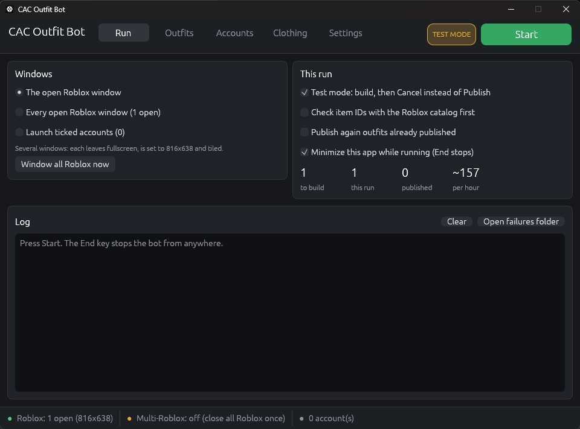
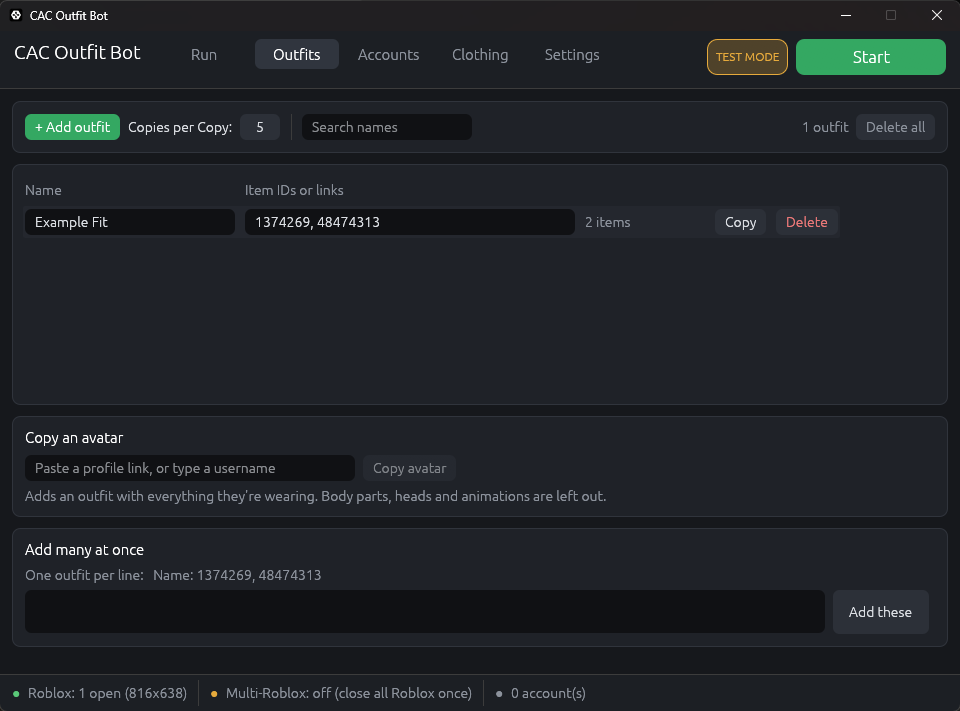
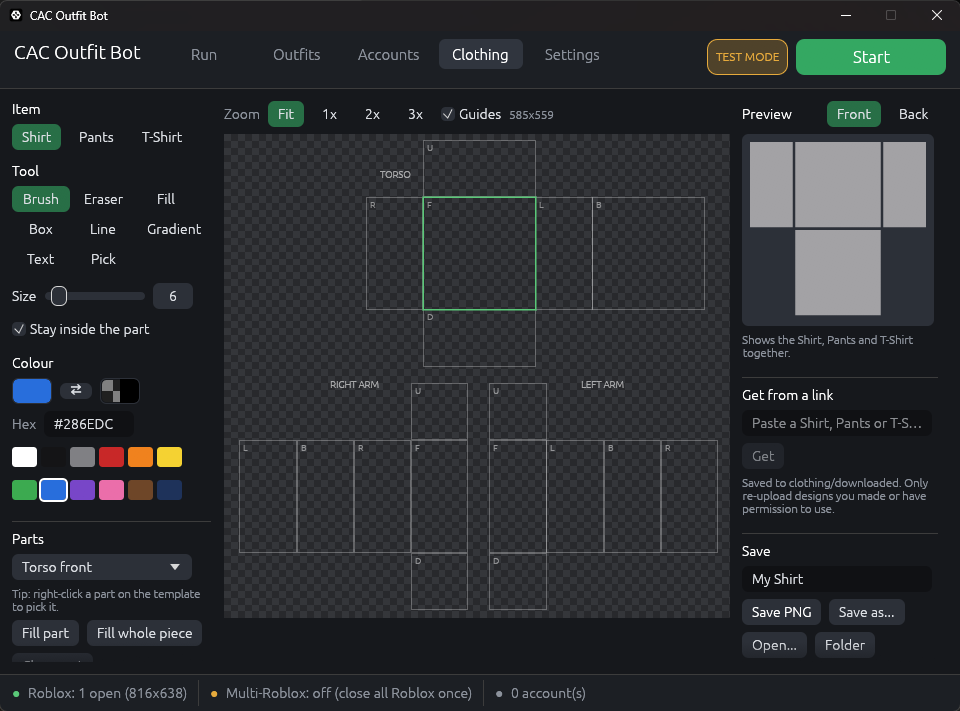

<div align="center">

# CAC Outfit Bot

**Build and publish outfits in Roblox's Catalog Avatar Creator automatically, and design your own classic clothing.**


[**Download the latest release**](../../releases/latest)



</div>

You give it outfits as lists of catalog item IDs. It opens Catalog Avatar Creator, removes
what the avatar is wearing, tries on each item, and publishes the outfit to CAC's Community
Outfits. It does this by moving the mouse and typing into the real Roblox window, like a
person would. No scripts are injected and no executor is used.

> [!WARNING]
> Automating a Roblox game breaks Roblox's Terms of Use. Accounts used with this bot can be
> banned, and accounts have been banned while testing it. Only use accounts you're willing to
> lose, keep runs small, and don't flood the outfit feed with copies of the same outfit.

## Features

- **One window, many accounts.** Sign in to several Roblox accounts and run them side by side.
  Multi-Roblox is built in, and windows are resized and tiled for you.
- **Safe test runs.** Test mode builds each outfit, then presses Cancel instead of Publish.
- **Copy any avatar.** Paste a profile link and get an outfit with everything that person is
  wearing.
- **Clothing studio.** Draw classic Shirts, Pants and T-Shirts on the official template, with a
  live preview on a body, or pull an existing item's template from its catalog link.
- **Recovers by itself.** Each click is checked against the screen, missed clicks are retried,
  and anything that goes wrong is skipped, screenshotted and retried on the next run.

<table>
  <tr>
    <td></td>
    <td></td>
  </tr>
  <tr>
    <td align="center">Outfits</td>
    <td align="center">Clothing</td>
  </tr>
</table>

## Getting started

1. Download `CAC-Outfit-Bot.zip` from the [latest release](../../releases/latest) and unzip it
   anywhere.
2. Open `CAC Outfit Bot.exe`.
3. On the **Accounts** tab, press **Sign in to Roblox** and sign in.
4. Add your outfits on the **Outfits** tab.
5. Leave **Test mode** on for the first run and press **Start**. Press **End** to stop at any
   time.

## Folders

| Folder | What's in it |
|---|---|
| `CAC Outfit Bot.exe` | The app (in the release download) |
| `data/` | Settings (`config.json`) and your outfits. Your saved accounts are kept here too, but never in the repo |
| `clothing/` | Your clothing designs, created when you first save one |
| `logs/` | `bot.log` and screenshots of anything that went wrong |
| `python/` | The older Python version of the bot |
| `source/` | The app's source code (Rust) |

## Using the app

Open `CAC Outfit Bot.exe` and press **Start**. Press **End** to stop. (F12 doesn't work for
this: in Roblox it starts a video recording.)

The app has five tabs.

### Run

Choose which Roblox windows to use: the one that's open, every open one, or launch the accounts
you've ticked. You can also turn on:

- Test mode: builds each outfit, then presses Cancel instead of Publish.
- Checking item IDs before starting.
- Publishing outfits again even if they were already published.

The tab shows progress for each window and a log.

### Outfits

Edit outfit names and item IDs. Catalog links work too. **Copy** makes N numbered copies of an
outfit. To add a lot at once, paste lines like `Name: id, id, id`.

**Copy an avatar** adds an outfit with everything someone is wearing. Paste their profile link
and it's looked up straight away, or type a username and press Enter. To copy one of your own
accounts, click its name under the box. Body parts, heads and animations are left out, since
CAC can't try those on.

### Accounts

**Sign in to Roblox** opens a login window. You sign in there yourself, and the account is saved
in `data/accounts.json`, encrypted with your Windows login. Don't share that file.

You can also add accounts by pasting a `.ROBLOSECURITY` cookie, or import them from Roblox
Account Manager. For the import, RAM needs to be open with Allow GetAccounts and Allow
GetCookie turned on. **Play in CAC** opens one account in the game.

### Clothing

Make classic Shirts, Pants and T-Shirts. Shirts and Pants use Roblox's 585x559 template;
T-Shirts are a 512x512 square. Each part of the template is outlined and labelled. Anything
outside the outlines doesn't show in game, so it's dimmed.

| Tool | Key |
|---|---|
| Brush | B |
| Eraser | E |
| Fill | G |
| Box | R |
| Line | L |
| Gradient | D |
| Text | T |
| Pick colour | I |

Other keys:

- `[` and `]` change the size.
- `X` swaps your two colours.
- Ctrl+Z and Ctrl+Y undo and redo.

Ways to work faster:

- **Stay inside the part** keeps a stroke from spilling over the edge of the part you started on.
- Right-click a part to select it, then fill it, fill that whole arm, leg or torso, clear it, or
  put an image on it. You can also drag an image file onto the window.
- **Symmetry** copies one arm or leg onto the other, mirrored.
- **Add shading** darkens edges and sides so flat colours look less flat.
- **Outline parts** draws a border around every part.
- The preview shows all three items on a body, from the front or the back.

**Get from a link:** paste the catalog link or ID of a classic Shirt, Pants or T-Shirt. It
downloads straight away, saves the template to `clothing/downloaded/`, and opens it in the
editor. Ctrl+Z brings back what was there before.

- Older items download without signing in.
- Newer items need a saved account that isn't banned.
- Only re-upload designs you made or have permission to use.

**Save PNG** saves to `clothing/<name>.png`, and **Open** loads a PNG to keep editing it. Your
current work is kept when you close the app.

**Uploading** is up to you; the app can't do it. Roblox only accepts clothing through the
Creator Dashboard (Avatar Items > Classics > Upload Asset). It costs 80 Robux per item and
needs ID verification. **Open upload page** opens the dashboard and shows the PNG in Explorer.
Once the item is on sale, add its ID to an outfit.

### Settings

Set outfits per window, the wait between outfits, window size, launch timing and delays.
Changes save automatically.

### Running several accounts

The app can run several Roblox windows at once. To do that it has to take Roblox's
single-instance lock, which only works if no Roblox is running when the app starts. If Roblox
was already open, close every Roblox window once. The status bar shows "Multi-Roblox: on"
when it's working.

With more than one window, each one is taken out of fullscreen, resized to 816x638 and tiled
before the bot starts. **Window all Roblox now** does this on demand.

To start a run as soon as the app opens (for a desktop shortcut), use
`CAC Outfit Bot.exe --start`.

## What happens for each outfit

1. Opens the Catalog, then the trash can. Ticks Accessories, Hair, Classic and Layered
   Clothing, and presses Remove. The body and face stay.
2. For each item ID: types it into the item link box, presses Enter, clicks Try On, and closes
   the item page. It never presses Buy.
3. Closes the catalog, opens Outfits, presses Publish, types the name and publishes.

Before each important click it checks a few pixel colours to make sure the right screen is
open, and clicks again if Roblox missed it.

If something still goes wrong, for example a bad item ID or a popup that never appears:

1. It saves a screenshot to `logs/failures/`.
2. It closes popups until it's back on CAC's main screen.
3. It skips that outfit. The outfit stays unpublished, so the next run tries it again.

After three problems in one window, it stops using that window.

## Python version

The original Python script still works and reads the same files. The app is easier to use;
use the script if you'd rather work from the command line.

Run these commands from the `python` folder. The scripts use the same `data/` and `logs/`
folders as the app.

Install the requirements (once):

```powershell
cd python
python -m pip install -r requirements.txt
```

Open CAC fullscreen on a 1920x1080 monitor, on its main screen. The button positions in
`data/config.json` are set for that size. Put your outfits in `data/outfits.json`, each with a `name`
and a list of `items` IDs.

Try a run that doesn't publish:

```powershell
python bot.py --test --check-items
```

If that looks right, publish for real:

```powershell
python bot.py --check-items
```

| Option | What it does |
|---|---|
| `--test` | Does everything, but presses Cancel instead of Publish |
| `--check-items` | Looks up every item ID first and drops ones that don't exist |
| `--limit N` | Publishes at most N outfits per window this run |
| `--redo` | Publishes outfits again even if they're in `published.json` |
| `--dry-run` | Prints the steps without touching the mouse |
| `--attach` | Uses every Roblox window that's already open |
| `--launch` | Opens the accounts listed in `config.json` through Roblox Account Manager first |

How a run behaves:

- It starts after 5 seconds. Don't touch the mouse or keyboard while it runs.
- **End** stops it, and so does moving the mouse into a screen corner.
- Published outfits are saved in `data/published.json`, so the next run skips them.
- `max_publish_per_run` and `seconds_between_outfits` in `data/config.json` set the defaults.
- Everything is logged to `logs/bot.log`.

### Several accounts with Roblox Account Manager

For `--launch` you need [Roblox Account Manager v4](https://github.com/niccsprojects/Roblox-Account-Manager)
(the Nexus + WebServer build). Set it up like this:

1. Add the accounts to RAM.
2. Close Roblox, then turn on Settings > General > Multi Roblox.
3. Turn on Settings > WebServer > Allow LaunchAccount. Leave Get Cookie and External
   Connections off.
   - If you set a password, put it in `data/config.json` under `ram.password`, or in the
     `RAM_PASSWORD` environment variable.
4. List the account usernames under `"accounts"` in `data/config.json`.

`python bot.py --launch --test` opens each account in CAC, waits `game_load_seconds`, then
starts. If you'd rather open the accounts from RAM yourself, use `--attach` instead.

### Window size

Button positions and screen checks are stored per window size, under `points` and `states` in
`data/config.json`. Each window has to be a size that has both.

A windowed Roblox has a title bar, so it lines up differently from fullscreen even at the same
size. To use windowed or smaller windows:

1. Open a window at that size.
2. Run `python calibrate.py`.
3. Add a `states` block for that size.
4. Set `launch_window_size` so launched windows open at that size.

### Changing the steps

The steps are listed in `data/config.json` under `flow`. Each step is one of these:

- `{"click": "point"}`. Can include:
  - `"expect": "state"` (wait for that screen and click again if it doesn't appear)
  - `"expect_not": "state"`
  - `"retries"` and `"timeout"`
- `{"wait_for": "state", "timeout": 6}`
- `{"type": "{item_id}"}` or `{"type": "{name}"}`
- `{"key": "enter"}` or `{"key": "ctrl+a"}`
- `{"wait": 1.5}`, or `{"wait": "equip_load"}` to use a named delay from `delays`

Any step can also have `"live_only": true` or `"test_only": true`. Those steps only run when
publishing for real, or only in test mode.

`states` are screen checks: a few `[x, y, [r, g, b]]` pixels, relative to the window, that all
have to match within `tol`. `recovery` says which button closes each screen.

To re-record button positions, run `python calibrate.py`, hover over each button and press F8.
`python calibrate.py try_on` re-records just one. If CAC moves its buttons, recalibrate those
and update `states`.

## Building from source

You need [Rust](https://rustup.rs) on Windows.

```powershell
git clone https://github.com/temporaryusername00/cac-outfit-bot.git
cd cac-outfit-bot/source
cargo build --release
```

The exe is built to `source/target/release/CAC-Outfit-Bot.exe`. Copy it to the repo's main
folder as `CAC Outfit Bot.exe`. It finds the `data/` folder next to it.
